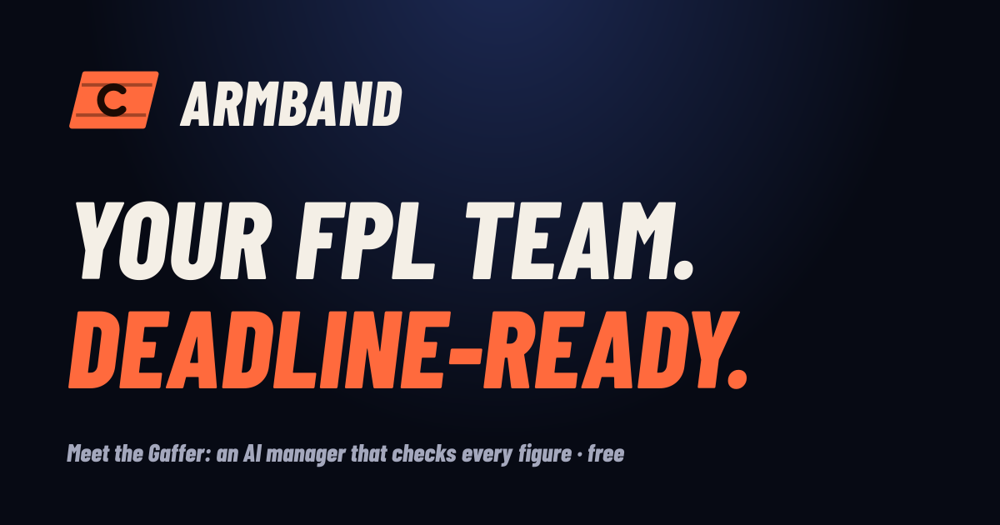
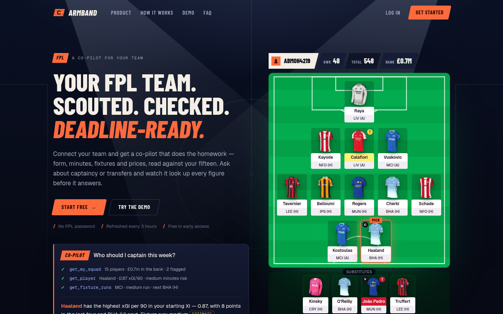
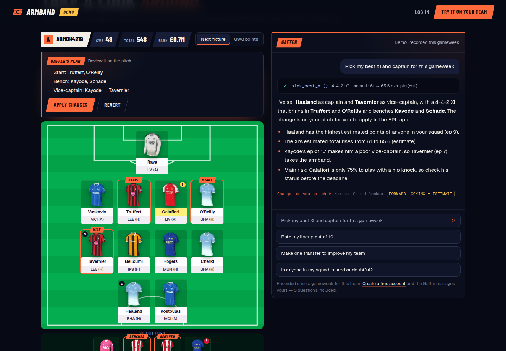
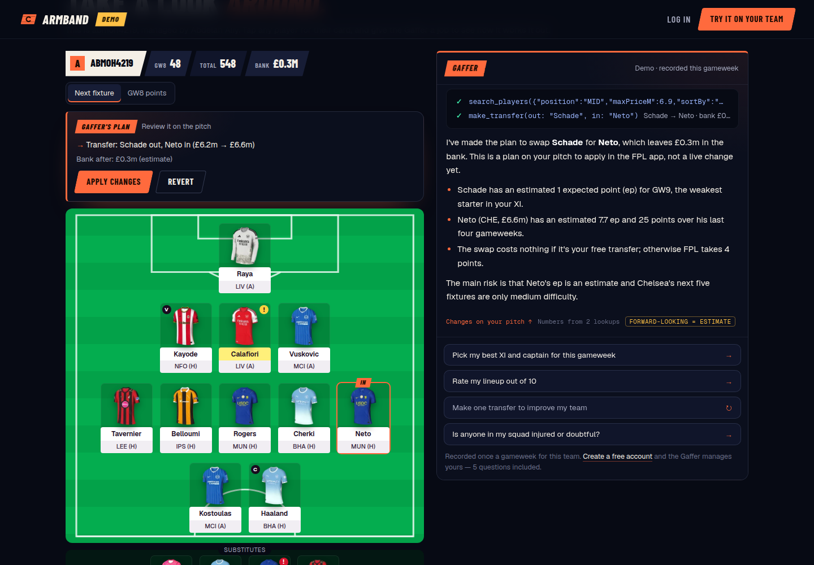
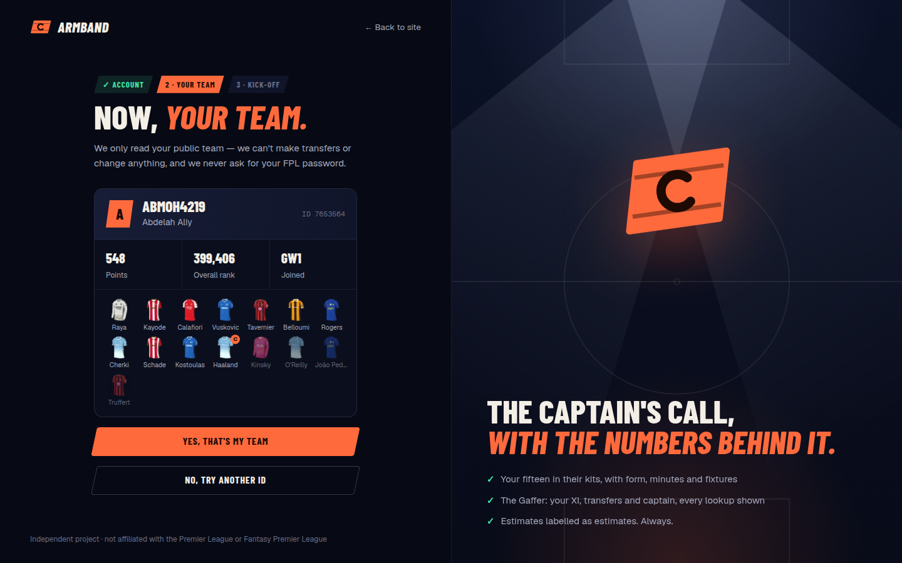
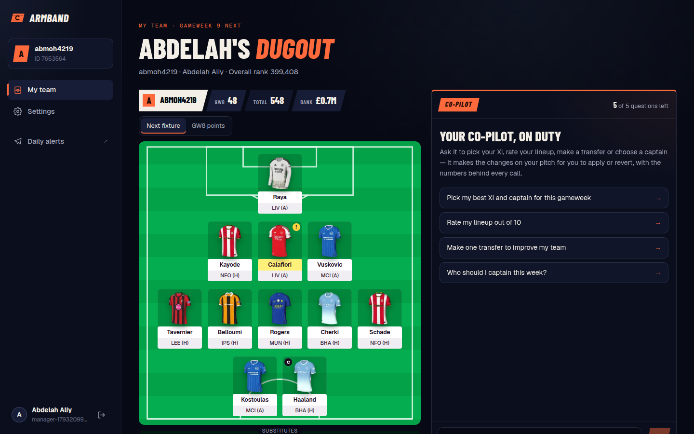
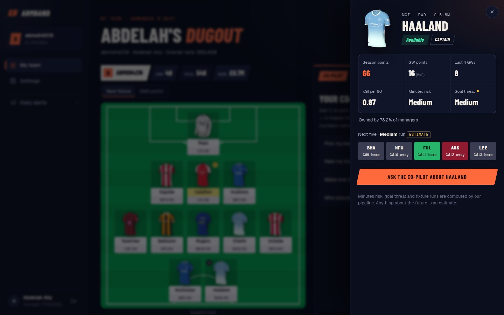
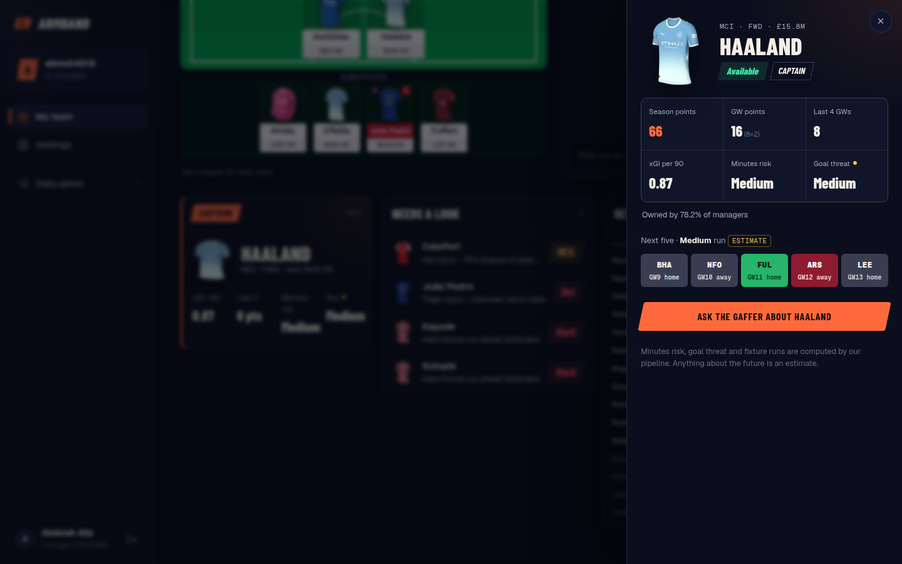
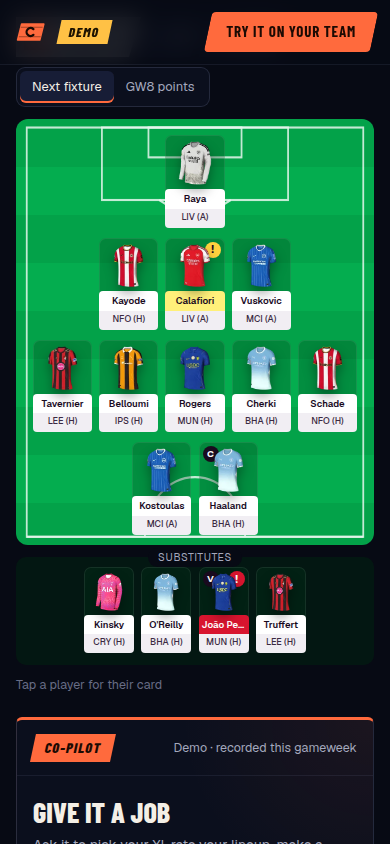

# Armband

**An AI manager for Fantasy Premier League.** Connect your FPL team and Armband
shows your fifteen on the pitch with the numbers that matter. Then give the
**Gaffer**, Armband's agent, a job: pick your XI, rate your lineup, make a
transfer, choose a captain. It makes the changes on your pitch for you to
apply or revert, and shows the working behind every call.

Behind it, a data pipeline watches FPL every few hours, detects price changes
and injury news, and posts the ones that matter to a Telegram channel.



## Highlights

- **The Gaffer: an agent, not a chatbot.** Claude Haiku 5.5 on the Messages
  API, with a tool loop of our own and its own FPL tools. It acts on a draft of your team: best XI, bench and captaincy
  changes, transfers. Every change shows on the pitch with **Apply** and
  **Revert**.
- **Code computes, the model decides.** Every number comes from a tested
  insight engine: form, xGI per 90 scaled by minutes, minutes risk, fixture
  difficulty, goal threat, captain score. The best XI is an exhaustive search
  over legal formations, and every transfer is rule-checked (positions, three
  per club, the bank). The model chooses what to do and explains it; it never
  invents a figure.
- **Honest by construction.** Estimates are labelled as estimates. Gemini's
  preview prose is rejected if it contains any number the code didn't
  compute. Questions outside FPL get one polite line and aren't counted.
- **Free-tier engineering.** GitHub Actions, Supabase, Vercel Hobby
  and Make's free plan, each with its budget worked out.
  Five questions per account, a daily spend cap, and a demo recorded
  once per gameweek and replayed to everyone.
- **Its own identity.** A floodlit "Matchnight" design system: condensed
  display type, slanted broadcast plates, chalk tactics-board illustrations,
  motion that respects reduced-motion settings.

## The Gaffer at work

Ask for a best XI and the Gaffer calls one tool, the pitch redraws, and
**Apply** or **Revert** decides. Every figure in the answer came from code.



Ask for a transfer and it searches the market, checks the move against FPL's
rules and your bank, and puts the new player on your pitch.



```text
pick_best_xi()   →  4-4-2 · C Haaland · 61 → 65.6 exp. pts (est.)
plan             →  Start: Truffert, O'Reilly · Bench: Kayode, Schade · Vice: Kayode → Tavernier
```

Measured on the real model: a best-XI answer takes two model turns, about
8 seconds, and costs about a tenth of a cent. Ask it something outside
football and it says so in one sentence, without using your allowance.

## A look around

| Connect your team | Your dugout |
| --- | --- |
|  |  |
| **Player cards** | **The squad check** |
|  |  |

<p align="center"></p>

## How it works

```
  FPL public API ─┐                      ┌─▶ Make.com ──▶ Telegram channel
  football-data ──┤   GitHub Actions     │   (one batched webhook per run;
  (CL dates)      └─▶ jobs/ (TypeScript) ─┤    Gemini writes preview prose,
                      snapshot · diff ·   │    validated back in code)
                      score · publish     │
                            │             └─▶ failure alerts straight to
                            ▼                 Telegram, bypassing Make
                        Supabase (Postgres)
                  core · app (RLS) · api (views)
                            │
                            ▼
                    Next.js on Vercel ──/api/agent──▶ the Gaffer, in-process:
                 landing · accounts · dugout ·        Claude Haiku 5.5 ⇄ our tools
                 demo, from read-only views           (read tools + action tools)
```

- **Watch:** `price-sync` runs every three hours, `daily-sync` nightly after
  FPL's price update. One `bootstrap-static` call per run and one
  `event/{gw}/live` call for every player's stats.
- **Detect:** each snapshot is diffed against the last: prices, availability,
  news text, ownership. Dedup keys make re-runs idempotent.
- **Decide:** the insight engine scores what matters. All weights live in one
  config file, with unit tests around them.
- **Deliver:** one webhook per run, only when there's news. Before each
  deadline a preview of captains, differentials and fixture swings.
- **Explain:** the Gaffer works from the same computed cards, through tools.
  See [docs/agent.md](docs/agent.md).

## Stack

| | |
| --- | --- |
| Language | TypeScript (strict), Zod at every external boundary |
| Web | Next.js 16 · React 19 · Supabase Auth (email and Google) |
| Agent | Claude Haiku 5.5 · Anthropic TypeScript SDK · our own streaming tool loop |
| Data | Supabase Postgres: three schemas, RLS, owner-privileged read views |
| Jobs | GitHub Actions cron · `tsx` |
| Automation | Make.com · Gemini (preview prose) · Telegram Bot API |
| Tests | Vitest: 280+ tests, including the database through its real API |

## Repository

| Path | |
| --- | --- |
| [`web/`](web) | Next.js app: landing, accounts, the dugout, the demo |
| [`agent/`](agent) | The Gaffer: tools, prompt, spend guards |
| [`jobs/`](jobs) | Sync, change detection, reports, delivery, alerts |
| [`packages/shared/`](packages/shared) | Schemas, the insight engine, squads and plans |
| [`supabase/migrations/`](supabase/migrations) | Every schema change, in order |
| [`docs/`](docs) | Architecture decisions and runbooks |

## Running it locally

Requires Node 22+, pnpm and Docker.

```bash
pnpm install
cp .env.example .env          # fill in what you need; every variable is explained
pnpm db:start                 # local Supabase
pnpm load:samples             # recorded API responses, loaded by the real loaders
pnpm test                     # all packages
pnpm --filter @fpl/web dev    # http://localhost:3000
```

`pnpm job:daily` syncs live FPL data into the local database.

## Docs

- [Architecture decisions](docs/decisions.md): fourteen ADRs, from storage to
  the agent
- [The Gaffer](docs/agent.md): the agent's tools, plans, limits, testing
- [Database](docs/database.md): schemas, security model, retention
- [Data dictionary](docs/data-dictionary.md): what the FPL API returns, and
  its traps
- [Operations](docs/operations.md): schedules, alerts, recovery
- [Make scenarios](docs/make.md) and [Deploying](docs/deploy.md)

---

Armband is an independent project, not affiliated with, endorsed by or
connected to the Premier League or Fantasy Premier League. It uses public data
only. Club kits belong to their clubs. Fixture runs, goal threat, captain picks
and price movements are estimates, never guarantees.
