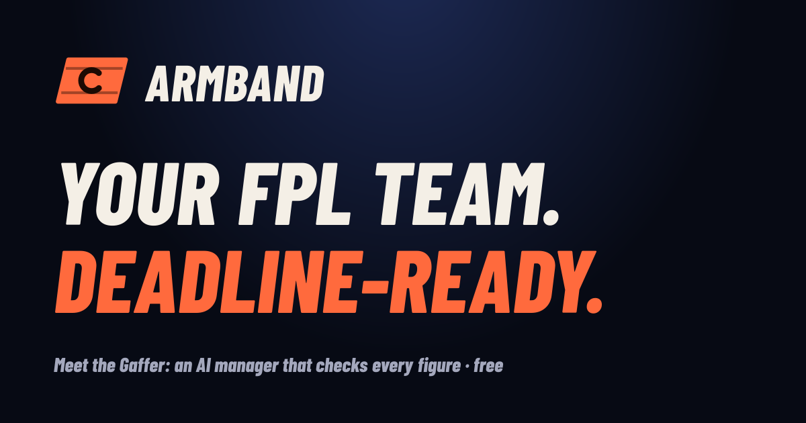

# Armband

[](https://github.com/abmoh4219/fpl-gameweek-copilot/actions/workflows/ci.yml)
[](LICENSE)
[](https://armband-one.vercel.app)

**Free, open-source tools for Fantasy Premier League.** Season stats, a
fixture planner, a price watch and a page for every player, with every number
shown. Enter your FPL team ID (no sign-up) and Armband shows your fifteen on the pitch, next
to the **Gaffer**: five checks computed in code (best XI, lineup rating,
captain, transfers within your bank, injuries). Each check shows its numbers
and puts its plan on your pitch for you to apply or revert.

Behind it, a data pipeline watches FPL every few hours, detects price changes
and injury news, and posts the ones that matter to a Telegram channel.

**[Live site](https://armband-one.vercel.app)** ·
**[Try the demo](https://armband-one.vercel.app/demo)** ·
[The agent (switched off)](docs/agent.md) ·
[Architecture decisions](docs/decisions.md)

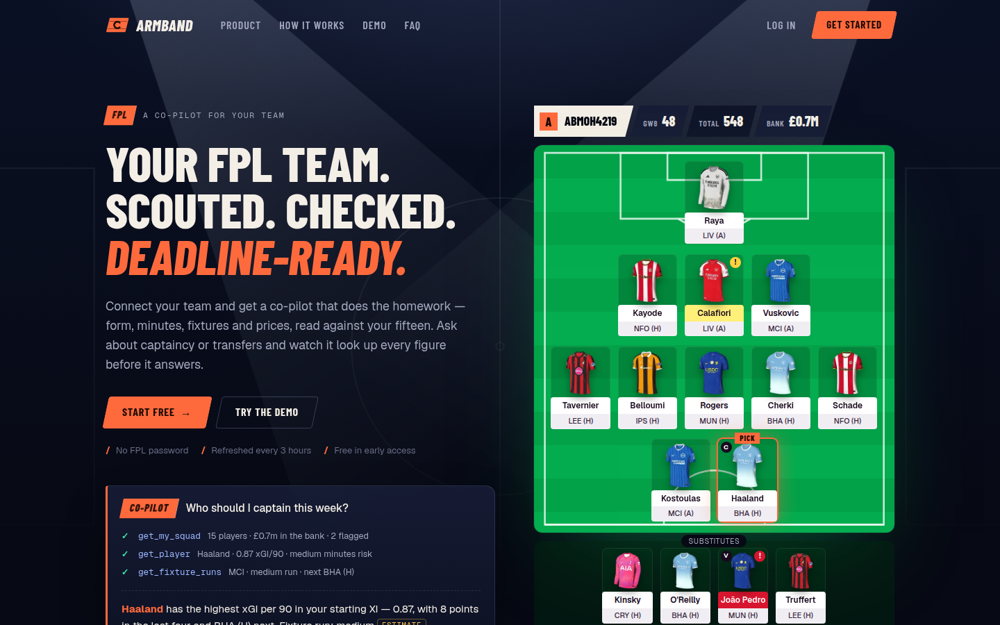

## Highlights

- **The Gaffer: five checks, no limits.** Best XI, lineup rating, captain,
  transfers and injuries, computed in code from FPL's data. The same squad
  always gets the same answer, and every plan shows on the pitch with
  **Apply** and **Revert** ([ADR-0016](docs/decisions.md)).
- **Code computes every number.** A tested insight engine: form, xGI per 90
  scaled by minutes, minutes risk, fixture difficulty, goal threat, captain
  score. The best XI is an exhaustive search over legal formations, and every
  transfer is rule-checked (positions, three per club, the bank).
- **Honest by construction.** Estimates are labelled as estimates, rankings
  show the numbers behind them, and Gemini's preview prose is rejected if it
  contains any number the code didn't compute.
- **An agent in the repo, switched off.** [`agent/`](agent) is a working
  Claude agent with its own tool loop and FPL tools. It ran the Gaffer until
  its key expired on 1 November 2026, and turns back on with a key and one
  environment variable ([docs/agent.md](docs/agent.md)).
- **Free-tier engineering.** GitHub Actions, Supabase, Vercel Hobby
  and Make's free plan, each with its budget worked out.
- **Its own identity.** A floodlit "Matchnight" design system: condensed
  display type, slanted broadcast plates, chalk tactics-board illustrations,
  motion that respects reduced-motion settings.

## The agent, when it was on

Before ADR-0016 the Gaffer was a Claude agent. Asked for a best XI, it called
one tool, the pitch redrew, and **Apply** or **Revert** decided. Every figure
in the answer came from code. The same engine now powers the five checks.

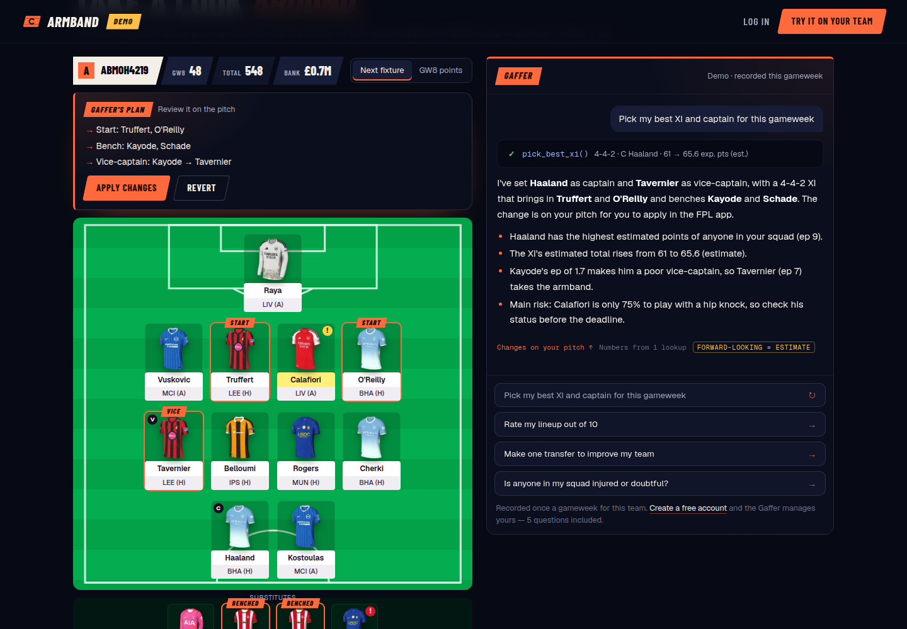

Ask for a transfer and it searches the market, checks the move against FPL's
rules and your bank, and puts the new player on your pitch.

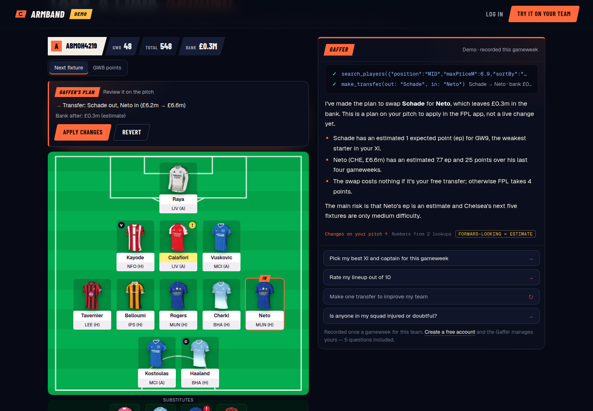

```text
pick_best_xi()   →  4-4-2 · C Haaland · 61 → 65.6 exp. pts (est.)
plan             →  Start: Truffert, O'Reilly · Bench: Kayode, Schade · Vice: Kayode → Tavernier
```

Measured on the real model: a best-XI answer took two model turns, about
8 seconds, and cost about a tenth of a cent.

## A look around

| Connect your team | Your dugout |
| --- | --- |
| 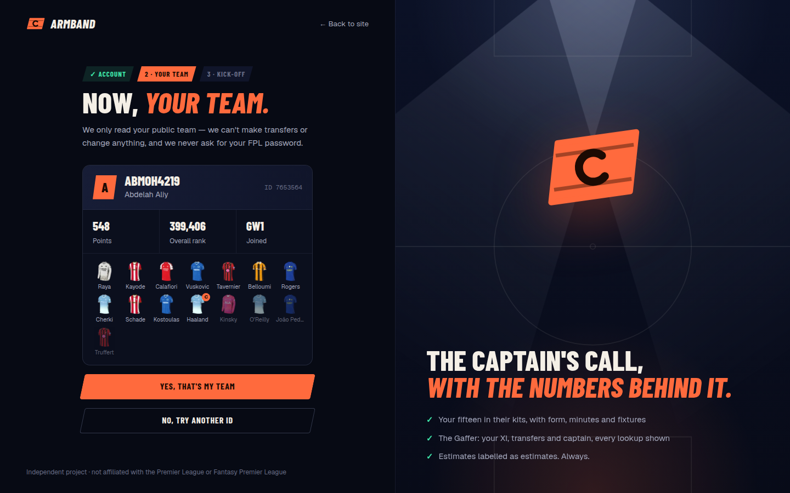 | 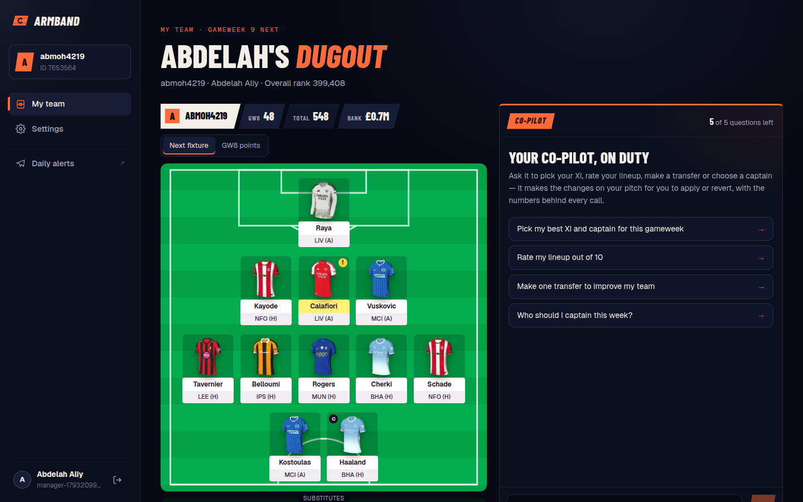 |
| **Player cards** | **The squad check** |
| 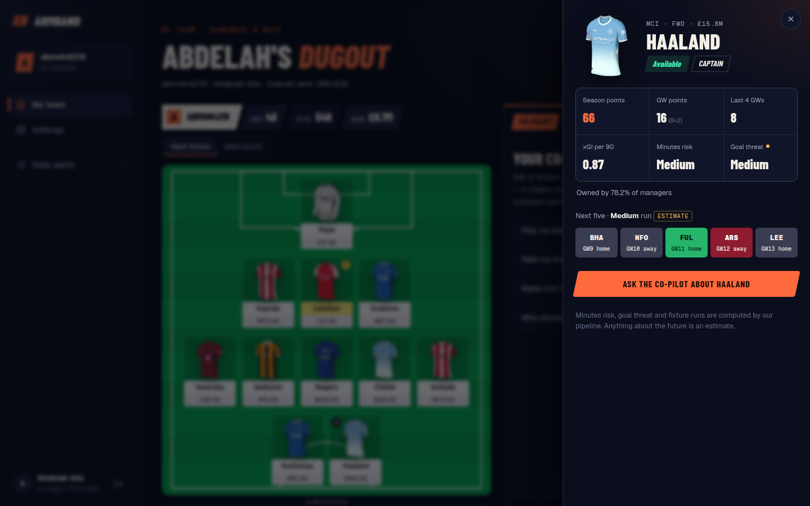 | 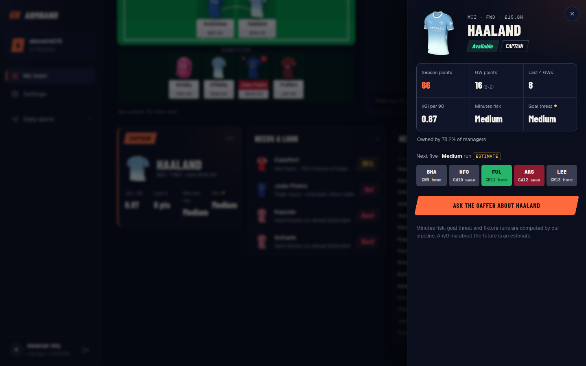 |

<p align="center">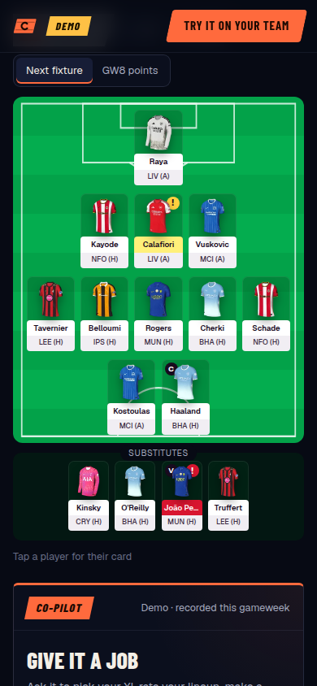</p>

## How it works

```
  FPL public API ─┐                      ┌─▶ Make.com ──▶ Telegram channel
  football-data ──┤   GitHub Actions     │   (one batched webhook per run;
  (CL dates)      └─▶ jobs/ (TypeScript) ─┤    Gemini writes preview prose,
                      snapshot · diff ·   │    validated back in code)
                      score · publish     │
                            │             └─▶ failure alerts straight to
                            ▼                 Telegram, bypassing Make
                        Supabase (Postgres)
                  core · app (RLS) · api (views)
                            │
                            ▼
                    Next.js on Vercel
                 landing · stats · fixtures · prices · players ·
                 your team by ID (no accounts) · the Gaffer · demo,
                 all from read-only views
```

- **Watch:** `price-sync` runs every three hours, `daily-sync` nightly after
  FPL's price update. One `bootstrap-static` call per run and one
  `event/{gw}/live` call for every player's stats.
- **Detect:** each snapshot is diffed against the last: prices, availability,
  news text, ownership. Dedup keys make re-runs idempotent.
- **Decide:** the insight engine scores what matters. All weights live in one
  config file, with unit tests around them.
- **Deliver:** one webhook per run, only when there's news. Before each
  deadline a preview of captains, differentials and fixture swings.
- **Explain:** the Gaffer's checks and every tool page read the same
  computed cards.

Make stays thin on purpose: code formats every message, so each scenario is a
handful of modules and a month of alerts fits well inside the free plan's
1,000 credits ([docs/make.md](docs/make.md)).

| Events: to the channel, and X drafts to the owner | Preview: Gemini prose, checked again in code |
| --- | --- |
| 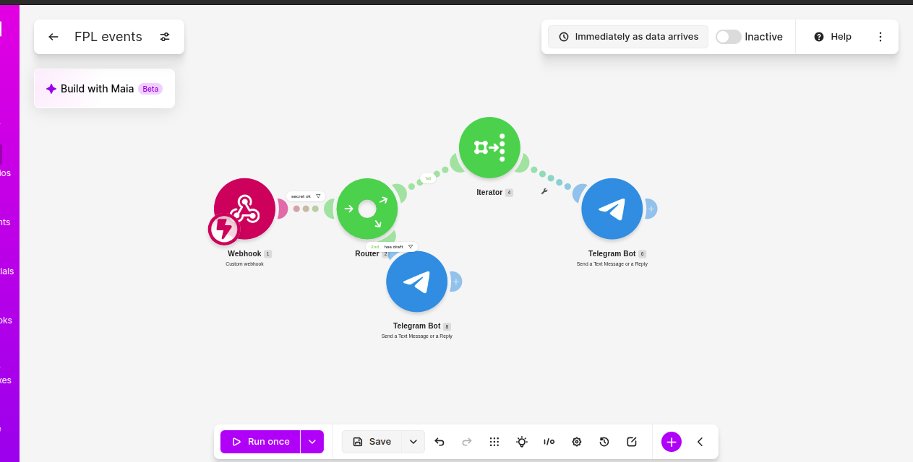 | 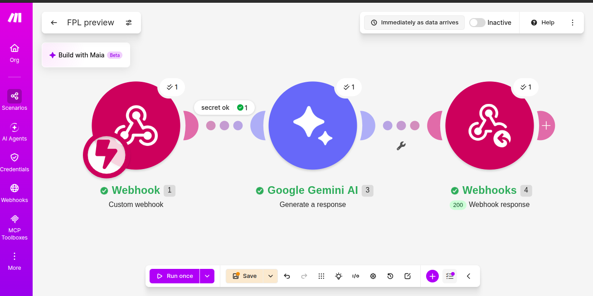 |

## Stack

| | |
| --- | --- |
| Language | TypeScript (strict), Zod at every external boundary |
| Web | Next.js 16 · React 19 · no accounts: your team by its public FPL ID |
| Agent (switched off) | Claude Haiku 5.5 · Anthropic TypeScript SDK · our own streaming tool loop |
| Data | Supabase Postgres: three schemas, RLS, owner-privileged read views |
| Jobs | GitHub Actions cron · `tsx` |
| Automation | Make.com · Gemini (preview prose) · Telegram Bot API |
| Tests | Vitest: 280+ tests, including the database through its real API |

## Repository

| Path | |
| --- | --- |
| [`web/`](web) | Next.js app: landing, tool pages, your team's dugout, the demo |
| [`agent/`](agent) | The Claude agent (switched off): tools, prompt, spend guards |
| [`jobs/`](jobs) | Sync, change detection, reports, delivery, alerts |
| [`packages/shared/`](packages/shared) | Schemas, the insight engine, squads and plans |
| [`supabase/migrations/`](supabase/migrations) | Every schema change, in order |
| [`docs/`](docs) | Architecture decisions and runbooks |

## Running it locally

Requires Node 22+, pnpm and Docker.

```bash
pnpm install
cp .env.example .env          # fill in what you need; every variable is explained
pnpm db:start                 # local Supabase
pnpm load:samples             # recorded API responses, loaded by the real loaders
pnpm test                     # all packages
pnpm --filter @fpl/web dev    # http://localhost:3000
```

`pnpm job:daily` syncs live FPL data into the local database.

## Docs

- [Architecture decisions](docs/decisions.md): seventeen ADRs, from storage to
  the agent
- [The agent](docs/agent.md): the switched-off Claude agent: tools, plans, limits, testing
- [Database](docs/database.md): schemas, security model, retention
- [Data dictionary](docs/data-dictionary.md): what the FPL API returns, and
  its traps
- [Operations](docs/operations.md): schedules, alerts, recovery
- [Make scenarios](docs/make.md) and [Deploying](docs/deploy.md)

## Contributing

Armband is free and open source, and contributions are welcome: bug reports,
new stat tables, accessibility fixes, better models. Start with
[CONTRIBUTING.md](CONTRIBUTING.md).

## License

[MIT](LICENSE) © Abdelah Mohammed Aliy. Built by [Abdelah](https://abdelah-portfolio.vercel.app/).

---

Armband is an independent project, not affiliated with, endorsed by or
connected to the Premier League or Fantasy Premier League. It uses public data
only. Club kits belong to their clubs. Fixture runs, goal threat, captain picks
and price movements are estimates, never guarantees.
