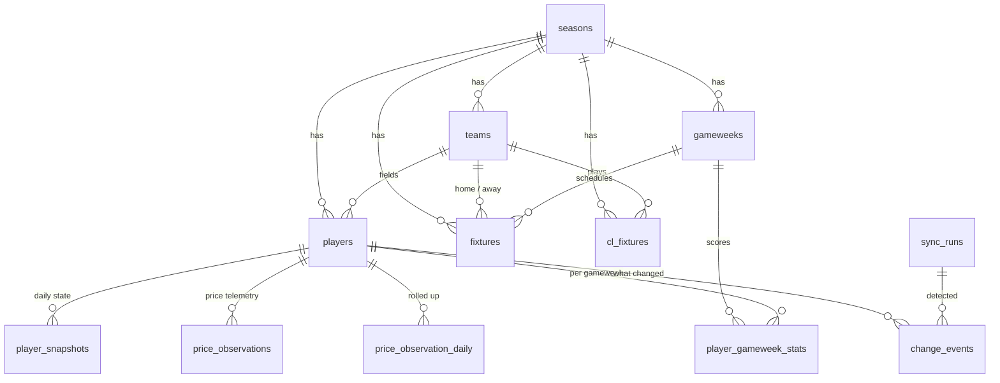

# Database

Postgres on Supabase. Every table is season-scoped, every load is an
idempotent upsert, and the public website never touches a table directly.

Schemas live in `supabase/migrations/`, created with the Supabase CLI and
**never edited after being pushed** — a change is always a new migration.

---

## Security model

Two schemas, one exposed:

```
                    Data API (PostgREST)
                            |
                     exposes `api` ONLY
                            |
        +-------------------+-------------------+
        |                                       |
   api.* views  (read-only, owner-privileged)   |
        |                                       |
        | read as their OWNER                   | anon: no grants at all
        v                                       X
   core.*  tables + job views  <--- jobs connect DIRECTLY over Postgres
                                    (service role / db password)
```

- **`core`** holds every table plus the views jobs use. It is **not exposed by
  the Data API at all**. RLS is enabled on every table with **no policies**, so
  even if the exposure setting were wrong, nothing would be served.
- **`api`** holds six read-only views. It is the **only** exposed schema.
- **`anon`** has `USAGE` on `api` and `SELECT` on those six views. It has
  **zero privileges on `core`**, and `ALTER DEFAULT PRIVILEGES` keeps it that
  way for future objects.
- **Jobs** do not use the Data API. Because only `api` is exposed, PostgREST
  refuses `core` even for the service role, so jobs connect straight to
  Postgres (ADR-0005).

### Why owner-privileged views, not `security_invoker`

The `api` views run as their owner and therefore **bypass RLS on `core`**. The
alternative, `security_invoker = on`, would run them as the caller and enforce
RLS — but that requires granting `anon` real `SELECT` on the `core` tables and
writing permissive policies to say "everyone may read everything".

| | `security_invoker = on` | **Owner-privileged (chosen)** |
| --- | --- | --- |
| `anon` needs on `core` | `USAGE` + `SELECT` + permissive RLS | **nothing** |
| Security boundary | the RLS policies | the view definition |
| Fails safe when | you forget a grant | you forget to filter a column |

Everything in this phase is public football data with no user-owned rows, so
RLS policies would be ceremony. Owner-privileged views give the smallest
possible grant surface, and each view is an explicit allow-list of the columns
we publish.

**The rule that follows:** when user-scoped tables arrive (waitlist, auth,
plans, rate limits), they get **RLS policies and `security_invoker` views**.
Public football data and per-user data never share a security model.

### Accepted Security Advisor finding

Supabase's Security Advisor flags the six `api` views as **"security definer
view"**. That finding is **deliberate and accepted** — it is the decision
above, working as intended.

**Those six views are the only advisor findings we accept.** Anything else the
advisor reports is a real problem and must be fixed, not documented away.

---

## Tables



| Table | Natural key | What it is for |
| --- | --- | --- |
| `seasons` | `name` | Anchors everything. FPL reassigns IDs every season |
| `teams` | `(season_id, fpl_id)` | Clubs, all six `strength_*` values, and the football-data id |
| `players` | `(season_id, fpl_id)` | Identity only — anything that changes lives in a snapshot |
| `gameweeks` | `(season_id, fpl_event_id)` | Deadlines (UTC), finished / current / next flags |
| `fixtures` | `(season_id, fpl_fixture_id)` | Premier League fixtures, FPL difficulty, scores. `gameweek_id` is **nullable** for postponements |
| `cl_fixtures` | `(football_data_match_id, team_id)` | Champions League matches of PL clubs. **One row per club**, so a PL-vs-PL tie produces two |
| `player_snapshots` | `(player_id, snapshot_date)` | One row per player per day: price, ownership, form, availability, season totals |
| `price_observations` | `(player_id, observed_at)` | Price telemetry, **deduped** (see below) |
| `price_observation_daily` | `(player_id, observed_on)` | Permanent daily rollup: open/close price, percent extremes, and the **signed** rate extremes (`min_rate`, `max_rate`, `close_rate`) |
| `player_gameweek_stats` | `(player_id, gameweek_id)` | From one `event/{gw}/live` call. Doubles are aggregated; `fixture_detail` keeps the per-fixture breakdown |
| `change_events` | `dedup_key` | Detected changes. The unique key makes double-sending impossible; `notified_at` is the Make queue |
| `sync_runs` | `id` | Every run, successful or not. **This is what makes price dedup lossless** |

### Type rules

- **Money is integer tenths.** `now_cost = 55` means £5.5m. Tenths everywhere
  in the data layer; converted only for display.
- **Statistics are `real` (float4).** Seven significant digits is ample for
  values FPL publishes to 2dp, and it saves ~25% on the two largest tables.
  No `numeric` anywhere — nothing here is currency arithmetic.

### Price observation dedup

A row is written **only when something differs** from that player's most recent
row: `now_cost`, `price_change_percent`, `price_change_hourly_rate`, the
projections array, `locked_until` or `calibrating`.

Nothing is lost, because **every run is recorded in `sync_runs`**. Absence of a
row means "unchanged since the row before it", not "not observed".

One implementation detail worth knowing: `jsonb` does not preserve key order,
so the projections comparison is done on values, not on a `JSON.stringify` of
the round-tripped object.

---

## Views

Six in `core` for jobs, the same six mirrored in `api` for the website.

| View | What it answers |
| --- | --- |
| `player_current` | Latest snapshot per player, joined to player and team, price in £m |
| `player_form` | Points, minutes, starts, xG, xA, xGI and xGI/90 over the last 4 and last 6 **finished** gameweeks |
| `fixture_ticker` | Next 5 unfinished gameweeks per team with difficulty and home/away. `is_blank` marks a gameweek with no fixture, `is_double` one with more than one |
| `price_changes_daily` | **Confirmed** risers and fallers, from consecutive daily snapshots |
| `price_watch` | Latest telemetry per player: percent, signed rate, momentum, strongest likelihood, locked flag. **Estimates only** |
| `cl_congestion` | For each upcoming PL fixture of a CL club: the gap since the previous CL match **and** until the next one |

Three rules the views encode:

- **Direction comes only from the sign of `price_change_percent`.** Never from
  the hourly rate, and never from `momentum`.
- **The hourly rate keeps its sign.** `hourly_rate` is signed and
  `hourly_rate_magnitude` is its absolute value; both are exposed. The working
  hypothesis is that percent is the **position** toward a change and the rate
  is the **current momentum**, so they can legitimately disagree — they do for
  113 of 667 players in the sample. The `momentum` column (`with` / `against`
  / null) labels that agreement and is **EXPERIMENTAL**: a hypothesis under
  observation, not a signal to act on (`docs/data-dictionary.md`, open
  question 2). `price_observation_daily` keeps `min_rate`, `max_rate` and
  `close_rate` forever so the hypothesis can be tested against real history.
- **`cl_congestion` covers Champions League games only.** The free
  football-data tier excludes the Europa League, Conference League and domestic
  cups, so the UI must say so.

### How many `cl_fixtures` rows to expect

The fetch window decides this, and the number is easy to misread. Five Premier
League clubs are in the competition and each plays once per league-stage
matchday, so **rows = PL clubs x matchdays in the window** (a PL-vs-PL tie
counts twice, once per club's perspective).

| Window | Matchdays covered | Rows |
| --- | --- | --- |
| 45 days forward only | 2, 3, 4 | 15 |
| 35 back + 45 forward (current) | 1, 2, 3, 4 | **20** |
| Whole remaining league stage | 2-8 | 35 |

The window **must look backward and include `FINISHED` matches**, or
`is_after_cl` can never fire and `days_since_cl` is always null. 35 days,
because matchday 1 ran 8-10 September and matchday 2 not until 13 October — a
33-day gap. It is still one request per day.

---

## Storage and retention

The free tier is **500 MB, including indexes**. These figures are **measured**,
not estimated: rows were loaded from `samples/`, then `VACUUM FULL ANALYZE`
was run and `pg_total_relation_size` divided by live tuples.

| Table | Measured bytes/row (heap + indexes) |
| --- | --- |
| `price_observations` | **491** |
| `player_gameweek_stats` | 479 |
| `player_snapshots` | 368 |
| `price_observation_daily` | 233 |

### Why retention is not optional

At one row per player per run, every 3 hours:

| Scenario | Rows/season | Size |
| --- | --- | --- |
| **No dedup, no retention** | 1,947,640 | **956 MB** — busts the tier alone |
| No dedup, 60-day window | 320,160 | 157 MB |
| **Dedup + 60-day window (chosen)** | ~272,000 | **~134 MB, and flat** |

The dedup figure assumes ~85% of players change between runs, which is the
share with non-zero telemetry in the captured sample. **That assumption is
unverified** — a single capture cannot show a change rate — so treat 134 MB as
an upper bound that should be re-measured once a few weeks of real runs exist.

### Season totals

| Table | Per season |
| --- | --- |
| `price_observations` (60-day window) | ~134 MB **steady state, does not grow** |
| `player_snapshots` | ~90 MB |
| `price_observation_daily` | ~57 MB |
| `player_gameweek_stats` | ~12 MB |
| `change_events` | ~11 MB |
| reference tables | < 1 MB |
| **Season 1** | **~304 MB** |
| **Season 2** | **~474 MB** |

**Season 1 fits. Season 2 arrives at the ceiling.** Before a second season
starts, `player_snapshots` needs its own retention rule — daily rows for 90
days, then weekly, would recover ~70 MB per season. That is a known, dated
piece of work, not a surprise.

### The retention function

`core.prune_price_observations(retain_days => 60)`:

1. Rolls every day older than the window into `price_observation_daily`
   (open/close price, min/max/close percent, **signed** min/max/close rate plus
   peak magnitude, strongest likelihood, whether a price change actually
   landed).
2. **Then** deletes the raw rows.

Idempotent — re-running for the same day overwrites the summary. Phase 3 calls
it from the daily sync job, which is simpler than `pg_cron` and runs on a
schedule we already have.

---

## Working with the database

```bash
pnpm db:start        # local stack (needs Docker)
pnpm load:samples    # samples/ -> local database, through the real loaders
pnpm db:reset        # re-apply every migration from scratch
pnpm db:stop
```

Migrations are created with `pnpm supabase migration new <name>` and are
**immutable once pushed**. To change something that already shipped, write a
new migration.

**Cloud setup**, once:

```bash
pnpm supabase login
pnpm supabase link --project-ref <your-project-ref>
pnpm supabase db push
```

Then, in the dashboard: **Project Settings → API → Exposed schemas** — remove
`public`, add `api`. Until that is done the website has nothing to read, and
`core` would be exposed if it were ever added to that list.
